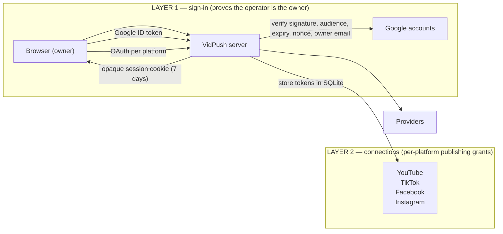
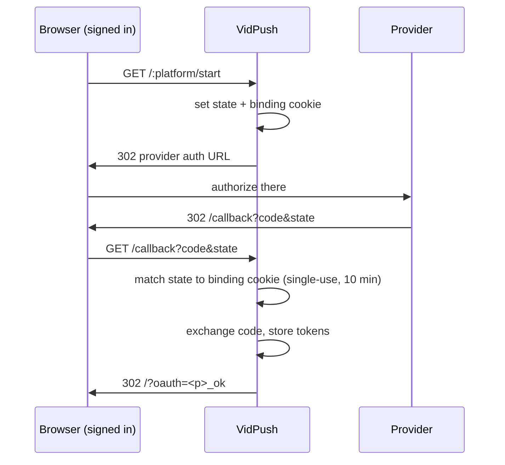
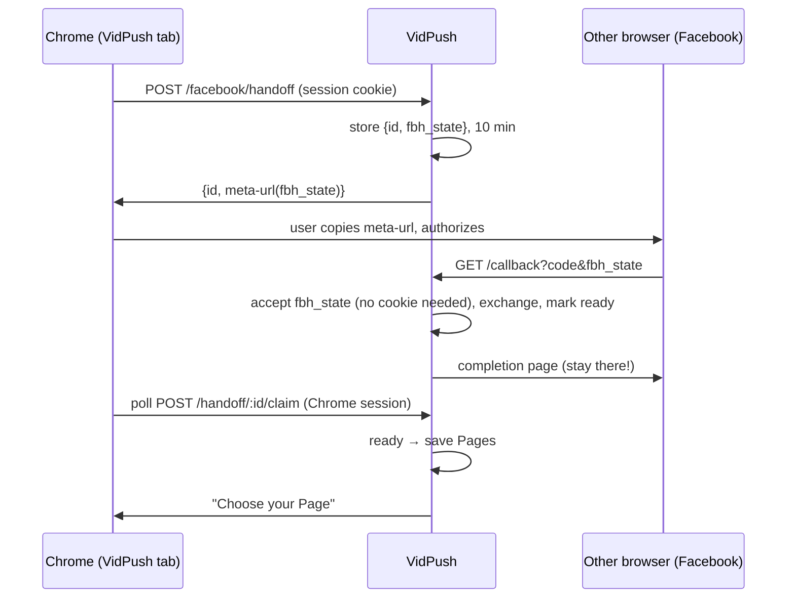

# VidPush authorization overview

Who VidPush thinks you are (sign-in) and which accounts it may publish to
(connections) are two independent layers. This page maps the choices for each
platform, with sequence diagrams. Setup values live in
[accounts.yaml](accounts.yaml); step-by-step setup is in
[Google sign-in setup](google-auth-setup.md), [Meta setup](meta-setup.md), and
[Modal deployment](modal.md).

## The two layers

- Sign-in grants access to the app. It never grants publishing rights.
- Each destination (YouTube, TikTok, Facebook Page, Instagram account) is
  connected separately and stores its own tokens under one shared owner
  workspace (`DEFAULT_USER_ID`).

## Layer 1: owner sign-in (choose one)

| Choice | Config | Behavior |
| --- | --- | --- |
| Google login (default, production) | `APP_AUTH_PROVIDER=google`, `GOOGLE_LOGIN_CLIENT_ID/SECRET/REDIRECT_URI`, `GOOGLE_ALLOWED_EMAIL` | Redirects to Google with scopes `openid email profile` plus a random `nonce`. The ID token's signature, audience, issuer, expiry, verified email, subject, and nonce are checked; only the allowed email passes. A random opaque session cookie is stored hashed in SQLite for 7 days. |
| Access-key fallback (local dev only) | `APP_AUTH_PROVIDER=key`, `VIDPUSH_API_KEY` | Unlock screen compares the key; Google mode rejects key unlocking outright. |

Google login rejects old deterministic session cookies, requires HTTPS
redirects except on `localhost`, and binds OAuth state to the initiating
browser (single-use, 10-minute, provider-specific cookie).

## Layer 2: publishing connections

| Platform | Credentials | Scopes | Authorizing browser | Callback |
| --- | --- | --- | --- | --- |
| YouTube | Separate Google OAuth client: `GOOGLE_CLIENT_ID/SECRET/REDIRECT_URI` | `youtube.upload`, `youtube` (offline, consent) | Same browser (cookie-bound state) | `/api/auth/google/callback` |
| TikTok | `TIKTOK_CLIENT_KEY/SECRET/REDIRECT_URI` | `user.info.basic`, `video.publish` | Same browser (cookie-bound state) | `/api/auth/tiktok/callback` |
| Facebook Page | `FACEBOOK_APP_ID/SECRET/REDIRECT_URI` | `pages_show_list`, `pages_read_engagement`, `pages_manage_posts` | Same browser AND other browser (handoff link, 10 min) | `/api/auth/facebook/callback` |
| Instagram | `INSTAGRAM_APP_ID/SECRET/REDIRECT_URI` (from Instagram API setup, not the Facebook app) | `instagram_business_basic`, `instagram_business_content_publish` | Same browser (cookie-bound state) | `/api/auth/instagram/callback` |

### Standard same-browser flow (login, YouTube, TikTok, Instagram)

If state, cookie, or code is missing/mismatched, the app returns to
`/?oauth=
_error&message=...` instead. That banner always means the
callback could not be matched to an initiation in that same browser.

### Facebook cross-browser handoff (the exception)

Facebook authorization often lives in a different browser than the VidPush
tab. The handoff replaces the cookie with a server-side pending record, so
the second browser needs no VidPush session at all.

Rules: only the initiating session can claim the result; a new Connect
invalidates the previous link; links expire after 10 minutes; the other
browser must see the completion page, never the VidPush app — landing in
VidPush there means the callback did not carry the `fbh_` state (for
example, a stale deployment predating the handoff).

## Environment choices

- Local (`FRONTEND_URL=http://localhost:5173`): TikTok needs a public HTTPS
  callback, so set private `NGROK_DOMAIN` in `.env` and use
  `./scripts/start-vidpush.sh`. When OAuth returns through ngrok while the
  initiation cookie belongs to localhost, the server bounces the callback to
  the matching `/complete` path on the UI origin so cookies line up.
- Modal (`modal deploy --env vidpush modal_app.py`): UI and API share one
  HTTPS origin, so same-browser flows and the Facebook handoff both work
  directly. The deployment is an image — pushing to GitHub does not update
  it; redeploy after pulling new auth code, otherwise the live app silently
  runs the old flow.

## Token and session lifecycle

- Sessions: random tokens, SHA-256 hash in SQLite, 7-day expiry, revoked on
  sign-out; changing the allowed email invalidates old sessions.
- YouTube/TikTok: access tokens plus refresh data in `oauth_accounts`.
- Facebook: chosen Page token in `oauth_accounts`, all authorized Pages in
  `facebook_pages`; expiry follows the long-lived user token.
- Instagram: long-lived token refreshed during use when under 7 days remain;
  expired or revoked grants need a reconnect.
- Upload jobs and pending OAuth/handoff records are in memory: one
  server/container, and finish uploads before redeploying or restarting.
